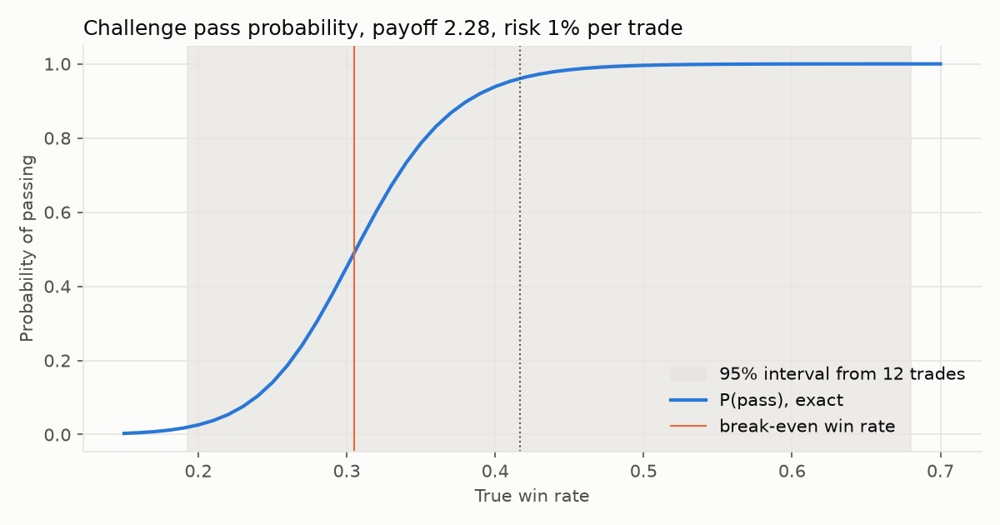
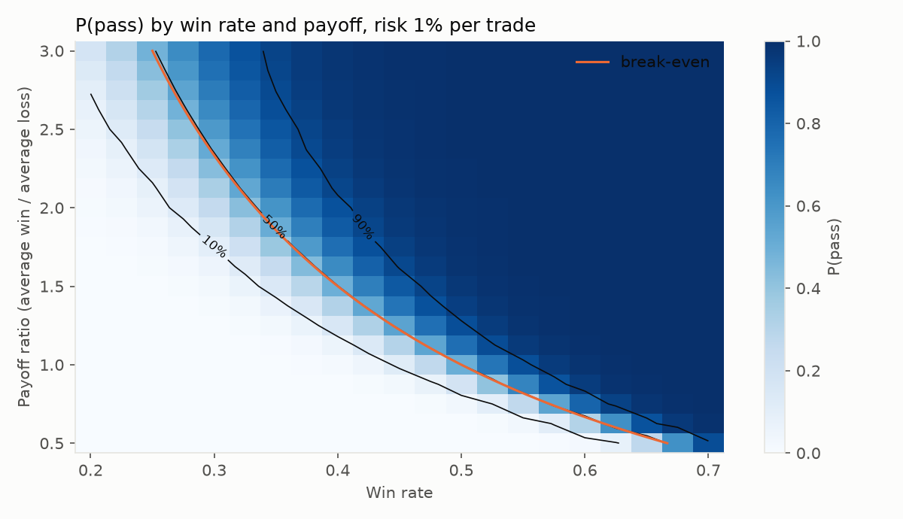
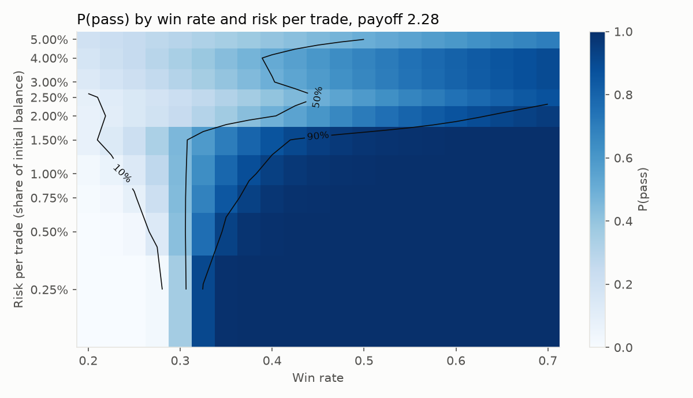
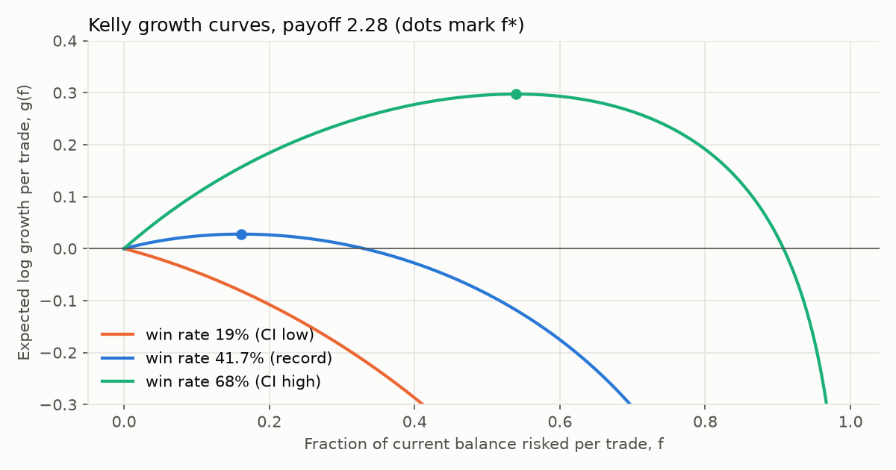
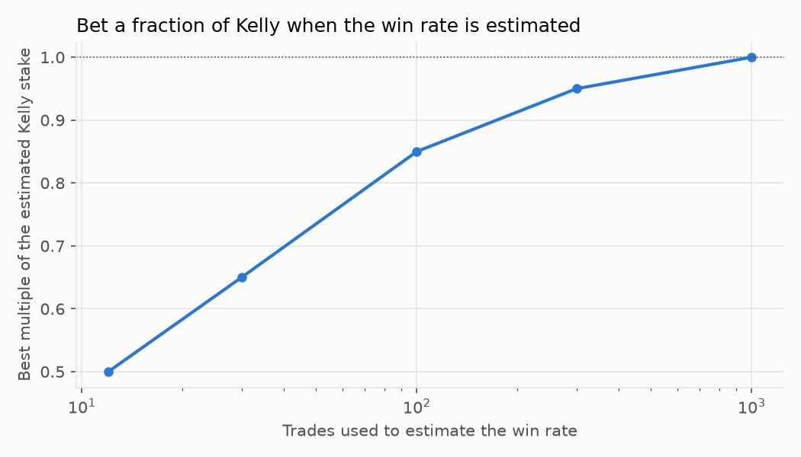

# Results

Generated by `python -m ruin_kelly`. Everything here is mathematics and simulation under stated assumptions; no market data is used. The win rate and payoff come from a self-reported record of 12 trades and are highly uncertain.

Python 3.14.6; numpy 2.5.4, scipy 1.18.1, pandas 3.1.0, matplotlib 3.11.2.

Monte Carlo runs use 200,000 simulated accounts per row.

## 1. Validation: equal wins and losses (no daily limit, 10% target, 10% loss limit)

| risk | win_rate | formula_pass | chain_pass | simulated_pass | simulation_se | formula_trades | chain_trades | simulated_trades |
|---|---|---|---|---|---|---|---|---|
| 1% | 0.40 | 0.017046 | 0.017046 | 0.0169 | 0.0003 | 48.30 | 48.30 | 48.18 |
| 1% | 0.45 | 0.118501 | 0.118501 | 0.1189 | 0.0007 | 76.30 | 76.30 | 76.46 |
| 1% | 0.50 | 0.500000 | 0.500000 | 0.5008 | 0.0011 | 100.00 | 100.00 | 99.96 |
| 1% | 0.55 | 0.881499 | 0.881499 | 0.8811 | 0.0007 | 76.30 | 76.30 | 76.23 |
| 2% | 0.40 | 0.116364 | 0.116364 | 0.1158 | 0.0007 | 19.18 | 19.18 | 19.20 |
| 2% | 0.45 | 0.268283 | 0.268283 | 0.2690 | 0.0010 | 23.17 | 23.17 | 23.12 |
| 2% | 0.50 | 0.500000 | 0.500000 | 0.5008 | 0.0011 | 25.00 | 25.00 | 24.99 |
| 2% | 0.55 | 0.731717 | 0.731717 | 0.7316 | 0.0010 | 23.17 | 23.17 | 23.12 |

## 2. Challenge (10% target, 10% overall, 5% daily, 3 trades a day), record edge (win rate 41.7%, payoff 2.28)

| risk | pass | fail_overall | fail_daily | expected_days | pass_within_60_days | simulated_pass |
|---|---|---|---|---|---|---|
| 0.25% | 100.0% | 0.0% | 0.0% | 37.5 | 91.6% | 100.0% |
| 0.50% | 99.8% | 0.2% | 0.0% | 19.3 | 99.2% | 99.8% |
| 1.00% | 96.1% | 3.9% | 0.0% | 9.5 | 96.1% | 96.1% |
| 1.50% | 89.6% | 10.4% | 0.0% | 5.8 | 89.6% | 89.5% |
| 2.00% | 53.0% | 0.0% | 47.0% | 2.4 | 53.0% | 53.1% |
| 3.00% | 52.6% | 0.0% | 47.4% | 1.4 | 52.6% | 52.7% |
| 5.00% | 41.7% | 0.0% | 58.3% | 1.0 | 41.7% | 41.8% |

### Same, but skipping any trade whose loss would breach the daily limit

| risk | pass | fail_overall | fail_daily | expected_days | pass_within_60_days | simulated_pass |
|---|---|---|---|---|---|---|
| 0.25% | 100.0% | 0.0% | 0.0% | 37.5 | 91.6% | 100.0% |
| 0.50% | 99.8% | 0.2% | 0.0% | 19.3 | 99.2% | 99.8% |
| 1.00% | 96.1% | 3.9% | 0.0% | 9.5 | 96.1% | 96.1% |
| 1.50% | 89.6% | 10.4% | 0.0% | 5.8 | 89.6% | 89.5% |
| 2.00% | 83.1% | 16.9% | 0.0% | 4.6 | 83.1% | 83.0% |
| 3.00% | 75.9% | 24.1% | 0.0% | 3.7 | 75.9% | 76.0% |

## 3. Pass probability across the plausible win rates (risk 1%)

| win_rate | pass | expected_days | expectancy_R |
|---|---|---|---|
| 0.15 | 0.3% | 7.1 | -0.51 |
| 0.20 | 2.6% | 9.9 | -0.34 |
| 0.25 | 14.1% | 14.1 | -0.18 |
| 0.30 | 45.2% | 17.0 | -0.02 |
| 0.35 | 78.6% | 14.7 | +0.15 |
| 0.40 | 93.9% | 10.6 | +0.31 |
| 0.45 | 98.4% | 7.8 | +0.48 |
| 0.50 | 99.6% | 6.0 | +0.64 |
| 0.55 | 99.9% | 4.8 | +0.80 |
| 0.60 | 100.0% | 4.0 | +0.97 |
| 0.65 | 100.0% | 3.4 | +1.13 |
| 0.70 | 100.0% | 3.0 | +1.30 |

## 4. Kelly

| case | win_rate | kelly_fraction |
|---|---|---|
| CI low | 0.193 | -0.161 |
| record | 0.417 | +0.161 |
| CI high | 0.680 | +0.540 |

| case | growth_full | growth_share_0.25x | growth_share_0.5x | growth_share_2x |
|---|---|---|---|---|
| record | 0.0279 | 45.2% | 76.2% | 10.1% |
| CI high | 0.2972 | 45.8% | 75.8% | – |

### Drawdowns over 500 trades (20,000 simulated paths, record edge)

| multiplier | fraction | growth | p_drawdown_20pct | p_drawdown_50pct | p_drawdown_80pct |
|---|---|---|---|---|---|
| 0.25 | 0.040 | 0.0126 | 100.0% | 24.0% | 0.0% |
| 0.50 | 0.080 | 0.0212 | 100.0% | 98.8% | 16.8% |
| 1.00 | 0.161 | 0.0279 | 100.0% | 100.0% | 99.0% |
| 2.00 | 0.322 | 0.0028 | 100.0% | 100.0% | 100.0% |

### Estimating the win rate from n trades, then betting a multiple of Kelly

| n_trades | best_multiplier | growth_share_at_best | growth_share_full_kelly | p_losing_growth_full_kelly | p_over_twice_kelly_full |
|---|---|---|---|---|---|
| 12 | 0.50 | 55.5% | -9.3% | 18.9% | 18.9% |
| 30 | 0.65 | 67.4% | 48.7% | 7.0% | 13.4% |
| 100 | 0.85 | 84.8% | 82.2% | 0.9% | 1.5% |
| 300 | 0.95 | 94.3% | 94.0% | 0.0% | 0.0% |
| 1000 | 1.00 | 98.2% | 98.2% | 0.0% | 0.0% |

